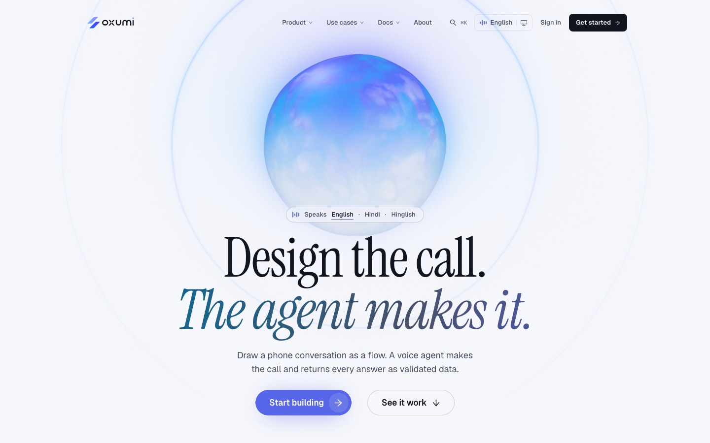
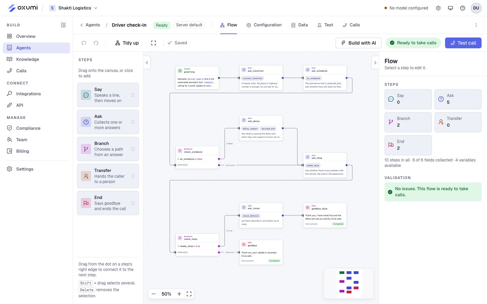
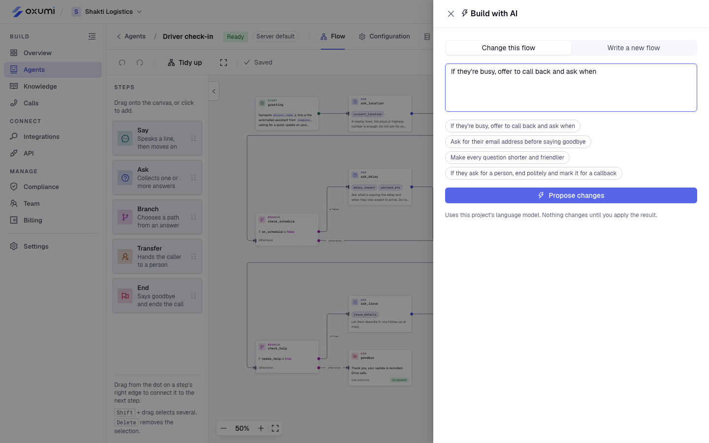
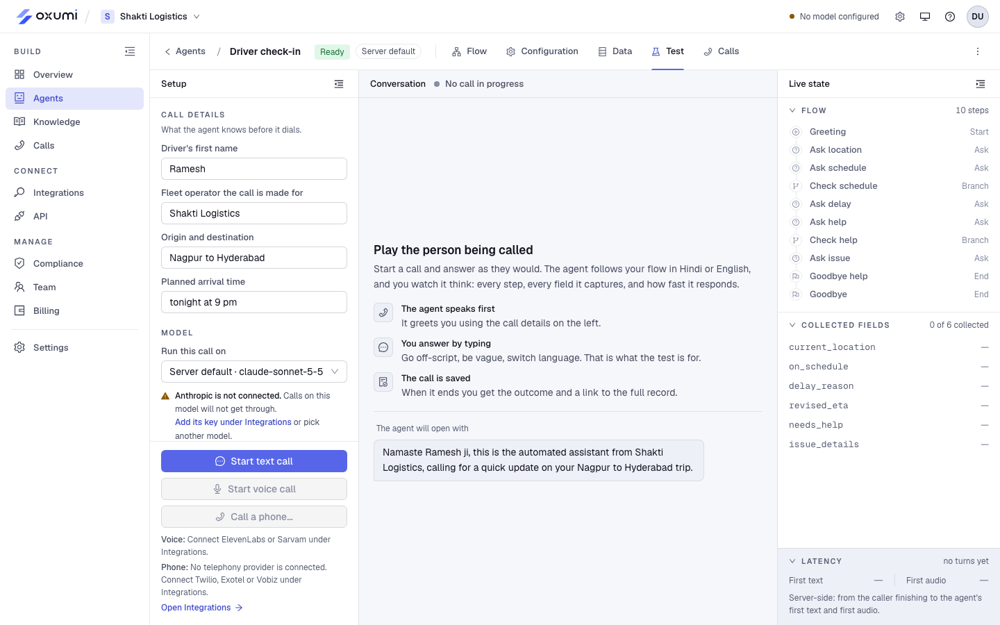
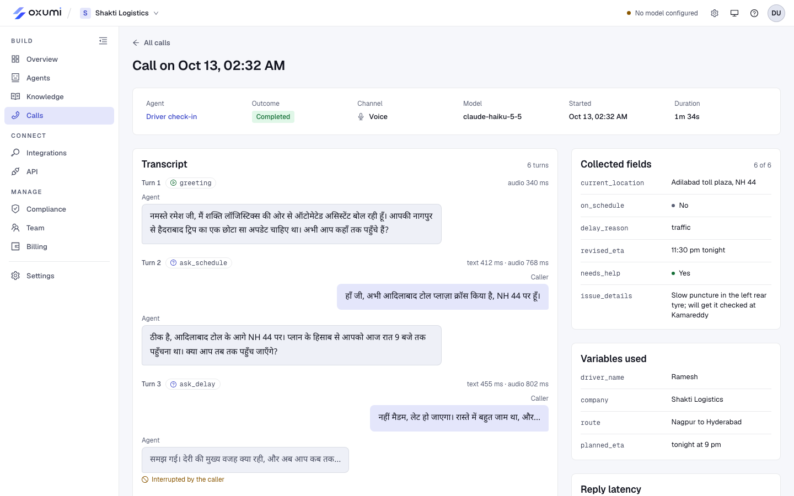
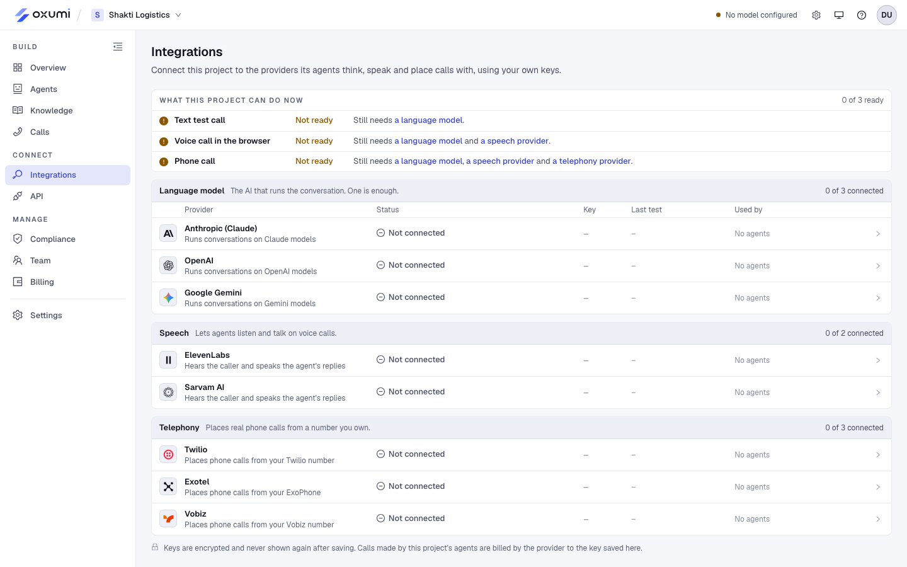
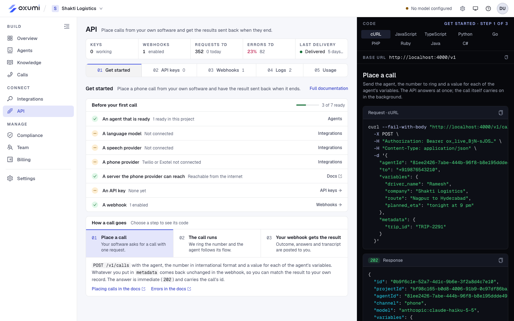
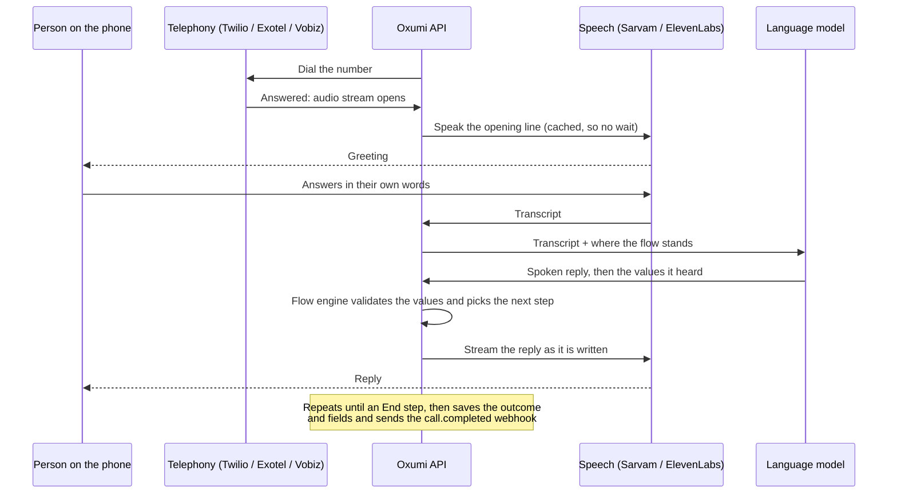

<p align="center">
  <picture>
    <source media="(prefers-color-scheme: dark)" srcset="apps/site/public/brand/logo/lockup-color-on-dark.svg">
    
  </picture>
</p>

<p align="center">
  <b>Design the call. The agent makes it.</b><br>
  Draw a phone conversation as a flow. A voice agent makes the call in Hindi, English or Hinglish,<br>
  and hands back every answer as validated data.
</p>

<p align="center">
  
</p>

## What it is

Businesses in India run on scripted phone calls: confirm an appointment, check on a driver, qualify a lead, remind someone about a service. Oxumi turns each script into a **flow** that a non-engineer draws in the browser. A voice agent then follows that flow on a real phone call and returns a structured result: an outcome, plus every field it was asked to collect, already checked against the flow's rules.

The use case lives in the flow, not in the code. One runtime serves browser test calls, phone calls and calls placed over the API.

- **Visual flow builder.** Start, Say, Ask, Branch, Transfer and End steps on a canvas, with live validation that says what blocks the agent from taking calls.
- **AI flow builder.** Describe the call in plain words, or the change you want, and get a complete flow to review step by step before applying it.
- **Hindi, English and Hinglish.** The agent answers in whichever the caller is using, with Sarvam or ElevenLabs for speech.
- **Structured results.** Every call ends with an outcome (completed, callback requested, wrong person, opted out, transferred, failed) and typed fields.
- **Test before you dial.** Play the person being called by text or voice in the browser, and watch each step, field and reply time live.
- **Real phone calls** through Twilio, Exotel or Vobiz, with transfer to a person.
- **Developer API and webhooks.** Place calls from your own software and get signed `call.completed` webhooks.
- **Run it as a business.** Per-project keys, team roles, a knowledge base for side questions, compliance (disclosure, consent, do-not-call), spend limits and an admin console.

## Screenshots

<table>
  <tr>
    <td width="50%"><br><sub><b>Flow builder.</b> Each step on the canvas, with validation on the right.</sub></td>
    <td width="50%"><br><sub><b>Build with AI.</b> Describe a change or a whole new flow; nothing changes until you apply it.</sub></td>
  </tr>
  <tr>
    <td><br><sub><b>Test console.</b> Play the person being called and watch the flow's state live.</sub></td>
    <td><br><sub><b>Call record.</b> Transcript, collected fields, variables and per-turn latency.</sub></td>
  </tr>
  <tr>
    <td><br><sub><b>Integrations.</b> Each project connects its own model, speech and telephony keys.</sub></td>
    <td><br><sub><b>API.</b> Keys, webhooks, logs and usage, with code samples in nine languages.</sub></td>
  </tr>
</table>

## How a call works



The **flow engine** (`packages/flow-core`) decides what happens; the language model only decides how to say it. The model is told what has been collected, what the current step needs and what comes next. Any value it records is checked against the flow's field types before the call moves on, so a call can only ever take the paths drawn in the builder.

More detail: [Architecture](docs/architecture.md) and [Flow format](docs/flows.md).

## Repository layout

This is a pnpm and Turborepo monorepo.

| Path | What it is | Dev port |
|---|---|---|
| [`apps/api`](apps/api) | NestJS API: auth, projects, agents, the call runtime, telephony, the public API, webhooks | 4000 |
| [`apps/web`](apps/web) | The app (Next.js): projects, the flow builder, test calls, call records, settings, admin | 3100 |
| [`apps/site`](apps/site) | Public site (Next.js): home page, API documentation, terms and privacy | 3000 |
| [`packages/flow-core`](packages/flow-core) | The flow format (zod schema), validation and the engine that runs a call step by step | |
| [`packages/ui`](packages/ui) | Shared design tokens, themes, brand assets and docs components | |
| [`flows`](flows) | Template flows offered when creating an agent | |
| [`models.config.json`](models.config.json) | Which language-model providers and models are offered, and the default | |

## Getting started

You need Node 24, pnpm 9 and Docker (for Postgres).

```sh
pnpm install
cp .env.example .env    # then fill in what you need; see below
pnpm db:up              # Postgres 17 on localhost:5434
pnpm dev                # API on :4000, app on :3100, site on :3000
```

Open <http://localhost:3100>, create an account, create a project and an agent (start from a template or describe it to AI), then connect a language model under **Integrations** and run a test call.

In development the database schema follows the entities automatically, and emails (password resets, invitations) are written to `.dev-outbox.log` instead of being sent.

Full setup, environment variables, phone calls through a tunnel and the admin console: [Development guide](docs/development.md).

## Common commands

| Command | Does |
|---|---|
| `pnpm dev` | Runs every app in watch mode |
| `pnpm build` | Builds every app and package |
| `pnpm typecheck` | Type-checks the whole workspace |
| `pnpm test` | Runs the API and flow-core test suites |
| `pnpm db:up` / `pnpm db:down` | Starts or stops Postgres |
| `pnpm db:psql` | Opens a SQL shell on the dev database |

## Documentation

- [Architecture](docs/architecture.md): the apps, the call pipeline, turn-taking and the data model
- [Flow format](docs/flows.md): steps, fields, variables, branches, outcomes and a full example
- [Development guide](docs/development.md): environment, providers, phone calls, admin, tests and deploying
- API reference: served by the site at <http://localhost:3000/docs> when running locally
