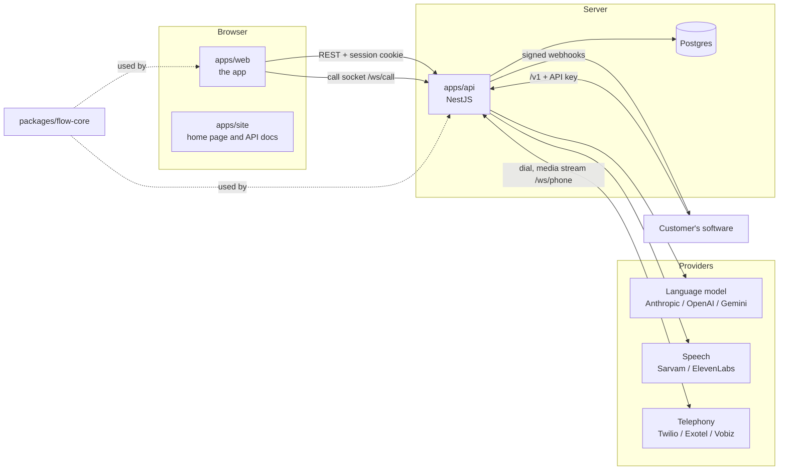

# Architecture

Oxumi is three apps and two shared packages in one pnpm and Turborepo workspace.

| Part | Responsibility |
|---|---|
| `apps/api` | Accounts and sessions, projects and members, agents, the call runtime, phone calls, the public `/v1` API, webhooks, provider keys, knowledge base, compliance, billing and the admin console |
| `apps/web` | Everything a signed-in user sees: projects, the flow builder, the AI flow builder, the test console, call records, integrations, API keys, team, settings and `/admin` |
| `apps/site` | The public home page, the API reference (`/docs`), terms and privacy |
| `packages/flow-core` | The flow format, its validation, and the engine that advances a call. The builder and the API share it, so what the builder shows as valid is exactly what runs |
| `packages/ui` | Design tokens, light and dark themes, brand assets and the code-sample components the docs use |

## The call runtime

A call is the same object whether it happens in the browser, on a phone or over the API. Only the transport differs.

| Channel | Transport | Audio |
|---|---|---|
| Browser text | `/ws/call` socket | none |
| Browser voice | `/ws/call` socket | 16 kHz PCM |
| Phone | Provider media stream (`/ws/phone`, `/ws/exotel`, `/ws/vobiz`) | 8 kHz mu-law or PCM |
| API text conversation | REST (`/v1/conversations`) | none |

Code lives in `apps/api/src/runtime`:

- **`CallSession`** runs one call: speech-to-text in, text-to-speech out, turn-taking, timing and teardown.
- **`Conversation`** owns the dialogue. It is text in and text out: it builds the model's input from the flow's state, streams the reply and hands recorded values to the engine.
- **`flow-core`'s engine** (`startCall`, `applyTurn`, `describeState`) is the source of truth for where the call is. The model never moves the call on by itself.

### One turn

1. Speech-to-text returns what the caller said.
2. `Conversation` sends the model the system prompt, the history and a `<flow_state>` block: what has been collected, what the current step needs, and what to say next once it has.
3. The model streams its spoken reply, then calls the `record_turn` tool with any values it heard and a `signal` (`none`, `callback_later`, `wrong_person`, `opt_out`, `human`, `not_reached`).
4. The engine coerces each value to its field's type, rejects what does not fit, counts attempts, follows branches and decides whether the call has ended.
5. The reply streams to text-to-speech phrase by phrase while it is still being written, so the caller hears the first words before the model has finished.

If the model records values but says nothing, a second words-only request asks for the reply. If that is empty too, the agent asks the caller to repeat themselves rather than go silent.

### Turn-taking on voice calls

- **Instant opening.** The opening line is spoken the moment the call connects rather than after a model round trip. For calls that open in Hindi it is translated once, with `{{placeholders}}` intact, and cached in memory. Phone calls prepare it while the phone is ringing.
- **No barge-in.** On browser and phone calls the agent finishes what it is saying when the caller talks over it. What the caller said is still transcribed live, and the answer to it is prepared while the current reply is still playing.
- **Settling.** Recognisers split one sentence at short pauses. The agent waits for 0.5 s of quiet (up to 2.5 s while the caller keeps talking) and answers the whole sentence once.
- **Latency.** Every turn records the time from the caller finishing to the first text and to the first audio. These are shown per call and as project medians.

### Providers

Each project connects its own keys under Integrations. Keys are encrypted at rest with AES-256-GCM using `CREDENTIALS_KEY`, and are never sent back to the browser. Keys in the server's environment act as a fallback for projects without their own.

| Kind | Providers | Where it is chosen |
|---|---|---|
| Language model | Anthropic, OpenAI, Google Gemini (any OpenAI-compatible endpoint can be added) | `models.config.json`, then per agent |
| Speech | Sarvam (Hindi-first), ElevenLabs | Per agent, or whichever the project has connected |
| Telephony | Twilio, Exotel, Vobiz | Per agent, or whichever the project has connected |

Phone providers connect back to the API, so phone calls need `PUBLIC_URL`: the API's address on the internet, or a tunnel in development.

## Access and accounts

- Signed-in users have an HTTP-only session cookie. Only a hash of each session token is stored.
- Project roles: **viewer** (read), **editor** (build agents, place calls), **admin** (keys, webhooks, compliance, spend limits, members) and **owner** (also deletes the project). Changes are written to a per-project audit log.
- The public API uses per-project API keys (`Authorization: Bearer ...`), rate-limited to 120 requests a minute. Every request is logged for the usage report.
- **Admins** (account role `admin`, granted by `ADMIN_EMAILS` or by another admin) get `/admin`: every account, its projects and usage. They can also sign in as a non-admin user for up to an hour. Password, email and account deletion stay blocked during such a session, and every one is logged.

## Webhooks

When a call ends, each enabled endpoint receives a `call.completed` event with the outcome, fields, transcript and the `metadata` the caller attached. Deliveries carry `Oxumi-Event`, `Oxumi-Delivery` and `Oxumi-Signature: t=<timestamp>,v1=<hex>`, where `v1` is HMAC-SHA256 of `"<timestamp>.<raw body>"` with the endpoint's secret. Failed deliveries are retried up to six times and can be re-sent from the app.

## Data model

Postgres, through TypeORM. In development the schema follows the entities automatically; production must run migrations.

| Area | Tables |
|---|---|
| Accounts | `users`, `sessions`, `password_resets` |
| Projects | `projects`, `project_members`, `project_invites`, `audit_events` |
| Agents and calls | `agents` (the flow is stored as JSON), `calls`, `turns` |
| Providers | `provider_credentials` (encrypted) |
| Public API | `api_keys` (hashed), `api_usage`, `webhook_endpoints`, `webhook_deliveries` |
| Knowledge base | `knowledge_sources`, `knowledge_chunks` (Postgres full-text search) |
| Compliance | `compliance_settings`, `consent_records`, `do_not_call` |
| Billing | `billing_settings` |
